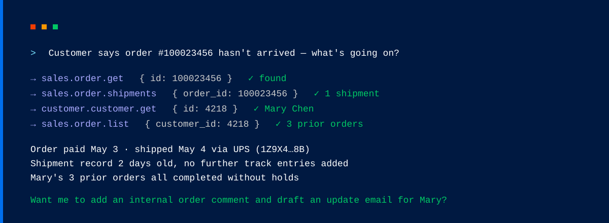

<p align="center">
  
</p>

# Magento 2 MCP module

Extensible [Model Context Protocol](https://modelcontextprotocol.io/specification/2025-06-18) server for Magento 2. Connect your store to any MCP-compatible AI agent — read and mutate customer, product, CMS or sales data, fetch reports, manage configuration, and more.

The base module ships the transport, authentication, ACL, audit log, and tool registry, plus a small set of system tools for inspecting and refreshing the store. Domain-specific functionality lives in optional sub-modules listed below — you can also write your own.

## Contents

- [What the base module gives you](#what-the-base-module-gives-you)
- [Quick start](#quick-start)
- [Installation](#installation)
- [Sub-modules](#sub-modules)
  - [Order module — `Magebit_McpOrderTools`](#order-module--magebit_mcpordertools)
  - [Catalog module — `Magebit_McpCatalogTools`](#catalog-module--magebit_mcpcatalogtools)
  - [Customer module — `Magebit_McpCustomerTools`](#customer-module--magebit_mcpcustomertools)
  - [Inventory module — `Magebit_McpInventoryTools`](#inventory-module--magebit_mcpinventorytools)
  - [CMS module — `Magebit_McpCmsTools`](#cms-module--magebit_mcpcmstools)
  - [Marketing module — `Magebit_McpMarketingTools`](#marketing-module--magebit_mcpmarketingtools)
  - [Tax and currency module — `Magebit_McpTaxTools`](#tax-and-currency-module--magebit_mcptaxtools)
  - [Report module — `Magebit_McpReportTools`](#report-module--magebit_mcpreporttools)
  - [Google Analytics module — `Magebit_McpGoogleAnalyticsTools`](#google-analytics-module--magebit_mcpgoogleanalyticstools)
  - [Hyvä Commerce module — `Magebit_McpHyvaCommerceTools`](#hyvä-commerce-module--magebit_mcphyvacommercetools)
  - [Database module — `Magebit_McpDbTools`](#database-module--magebit_mcpdbtools)
- [Setup](#setup)
- [Managing tools](#managing-tools)
- [Configuration writing](#configuration-writing)
- [Background jobs](#background-jobs)
- [Connecting an AI agent](#connecting-an-ai-agent)
  - [Bearer token](#bearer-token)
  - [OAuth 2.1](#oauth-21)
- [Security](#security)
- [Extending](#extending)
- [Upgrading to 2.0](#upgrading-to-20)
- [Contributing](#contributing)

## What the base module gives you

- A `POST /mcp` JSON-RPC endpoint with bearer-token and OAuth 2.1 authentication
- Per-tool admin-role ACL and a two-layer write kill-switch
- A PII-redacting audit log with configurable retention
- Per-(admin, tool) rate limiting
- An origin allowlist with sensible defaults for major AI clients
- Core tools for the authenticated identity, cache types, indexers, store views, installed modules (`system.module.list`, for checking what the store actually supports before picking a tool), system configuration values and admin notifications
- Configuration writing (`system.config.set`), off by default and allowlist-only — see [Configuration writing](#configuration-writing)
- A bulk tool contract and background jobs: a bulk tool takes `items[]`, reports one result per item, and runs as a queued job above its synchronous cap. The core ships the four job tools (`system.job.get`, `system.job.list`, `system.job.cancel`, `system.job.resume`) — see [Background jobs](#background-jobs)
- Scheduled-job diagnostics (`system.cron.status`), so the AI can answer "why didn't that run automatically?" — per-job last success/error, stuck-job detection, and per-group retention. Absent run history is not evidence a job never ran: Magento prunes successful cron rows aggressively (60 minutes by default), so `no_run_history` is normal for most of the day on any job that doesn't run every few minutes
- Read-only log diagnostics (`system.log.list` / `system.log.tail` / `system.log.grep`), so the AI can read `var/log` without shell access — basename-only, `.log` files only. Every read is bounded (line and match caps, a total byte budget) and never loads a whole file. Log lines routinely contain customer PII, tokens, or credentials, so grant the underlying tool ACLs to admin roles accordingly
- MCP prompt support (see examples in [Prompt/System](Prompt/System/) directory)

## Quick start

The fastest path from `composer require` to a connected AI is the interactive **[Quick Setup guide](https://magebit.com/magento-mcp)** — pick which AI you're using (Claude, ChatGPT, Cursor, Claude Code, or anything else MCP-compatible) and follow the per-client steps with copy-paste snippets and admin-screen screenshots.

Not connecting? The **[Connection Checker](https://magebitcom.github.io/magento2-mcp-module/quick-setup/diagnose.html)** probes your store's MCP endpoints from the browser and flags redirects, unreachable hosts and base-URL mismatches; the **[MCP Inspector guide](https://magebitcom.github.io/magento2-mcp-module/quick-setup/inspector.html)** walks you through verifying the OAuth sign-in and bearer-token access end to end.

For the long-form reference — every admin setting, the OAuth and bearer-token flows in detail, and the full tool catalog — see the [Wiki](https://github.com/magebitcom/magento2-mcp-module/wiki).

**Setting this up with an AI coding agent?** Point it at [docs/AGENTS.md](docs/AGENTS.md) — the same install written as a command-line-only runbook, with a verification step after each stage so the agent can tell whether it worked instead of guessing.

## Installation

```bash
composer require magebitcom/magento2-mcp-module
bin/magento module:enable Magebit_Mcp
bin/magento setup:upgrade
```

That gives you the server and its `system.*` tools, and nothing else.

### Installing everything at once

To get the server plus the catalog, CMS, customer, inventory, marketing, order, report and tax modules in one step, require the [suite meta-package](https://github.com/magebitcom/magento2-mcp-suite) instead of picking sub-modules by hand:

```bash
composer require magebitcom/magento2-mcp-suite
bin/magento setup:upgrade
```

The suite contains no code of its own — only a dependency list — so what it installs is nine ordinary Magento modules. That means you stop choosing your tool surface at `composer require` time and start choosing it in `app/etc/config.php`, where `1` is enabled and `0` is disabled:

```php
'modules' => [
    // ...
    'Magebit_Mcp' => 1,
    'Magebit_McpCatalogTools' => 1,
    'Magebit_McpCmsTools' => 1,
    'Magebit_McpCustomerTools' => 1,
    'Magebit_McpInventoryTools' => 1,
    'Magebit_McpMarketingTools' => 1,
    'Magebit_McpOrderTools' => 1,
    'Magebit_McpReportTools' => 0,
    'Magebit_McpTaxTools' => 0,
],
```

`bin/magento module:disable Magebit_McpReportTools` edits the same file. Because `config.php` is committed, this is how you give each environment a different tool surface from one install — full write access on staging, a narrower set in production.

Two caveats worth knowing:

- **`setup:upgrade` enables modules it has not seen before.** Adding the suite to an existing store lands all nine as `=> 1`. If some should be off, disable them in the same deploy, before the store serves traffic.
- **Disabling a module is a blunt instrument.** To keep one installed but hide individual tools, use **System → MCP → Tools** in the admin, which toggles a single tool at a time behind its own ACL resource.

The Google Analytics, Hyvä Commerce and database modules are deliberately **not** in the suite — the first needs a Google login and pulls in the Google SDKs, the second needs Hyvä Commerce, the third grants bulk database reads. All three are listed below and are one `composer require` away.

## Sub-modules

Each sub-module is published independently and depends on `Magebit_Mcp`. Install only the ones you need. After every `composer require` below, enable and rebuild Magento with:

```bash
bin/magento module:enable Magebit_Mcp<Name>Tools
bin/magento setup:upgrade
```

Every tool module — ours and third-party ones — carries the [`magebit-mcp-tools`](https://github.com/topics/magebit-mcp-tools) GitHub topic, so browsing that topic lists the full ecosystem, including modules not documented here.

### Order module — [`Magebit_McpOrderTools`](https://github.com/magebitcom/magento2-mcp-order-tools)
- Read and search orders, invoices, shipments, payments, order comments and credit memos
- Create invoices, shipments, shipment tracks, credit memos and order comments
- Cancel, hold or unhold orders

```bash
composer require magebitcom/magento2-mcp-order-tools
```

### Catalog module — [`Magebit_McpCatalogTools`](https://github.com/magebitcom/magento2-mcp-catalog-tools)
- Read and search products and categories
- Create, update or delete products
- Create, update or delete categories
- Set stock levels in bulk, and upload or manage product images

```bash
composer require magebitcom/magento2-mcp-catalog-tools
```

### Inventory module — [`Magebit_McpInventoryTools`](https://github.com/magebitcom/magento2-mcp-inventory-tools)
- Read sources, stocks and per-source quantities
- Report salable quantity and the reservations behind it
- Set or unassign quantities per (SKU, source) in bulk
- Manage sources, stocks, source links and website assignments
- Bulk assign, unassign and transfer inventory between sources

Requires Magento's Multi-Source Inventory. For a single-stock store,
`catalog.product.stock.set` in the catalog module is enough.

```bash
composer require magebitcom/magento2-mcp-inventory-tools
```

### Customer module — [`Magebit_McpCustomerTools`](https://github.com/magebitcom/magento2-mcp-customer-tools)
- Read or search customers, addresses and customer groups
- Fetch customer confirmation status
- Create, update or delete customers and addresses
- Trigger password reset or resend confirmation

```bash
composer require magebitcom/magento2-mcp-customer-tools
```

### CMS module — [`Magebit_McpCmsTools`](https://github.com/magebitcom/magento2-mcp-cms-tools)
- Read or search CMS pages and blocks
- Create, update or delete CMS pages and blocks

```bash
composer require magebitcom/magento2-mcp-cms-tools
```

### Marketing module — [`Magebit_McpMarketingTools`](https://github.com/magebitcom/magento2-mcp-marketing-tools)
- Read or search catalog rules, cart rules and coupons
- Delete, toggle and apply catalog and cart rules
- Generate or delete coupon codes

```bash
composer require magebitcom/magento2-mcp-marketing-tools
```

### Tax and currency module — [`Magebit_McpTaxTools`](https://github.com/magebitcom/magento2-mcp-tax-tools)
- Read or search tax rates, tax rules and tax classes
- Create, update or delete tax rates, rules and classes
- Read currency configuration (base, default and allowed currencies)
- Set currency exchange rates manually or import them from the configured service

```bash
composer require magebitcom/magento2-mcp-tax-tools
```

### Report module — [`Magebit_McpReportTools`](https://github.com/magebitcom/magento2-mcp-report-tools)
- Cart reports (products in cart, abandoned carts)
- Popular search queries and newsletter problems (bounces, send failures)
- Product reviews, review counts and average ratings
- Aggregated sales reports for orders, tax, invoices, shipments, refunds and coupons
- Customer reports (orders, totals, new customers, online visitors)
- Product reports (most viewed, bestsellers, low-stock, qty ordered, downloads)
- Dashboard summary (lifetime sales, average order, revenue for a period, recent orders, top search terms, top bestsellers)
- Refresh sales/customer/review statistics

```bash
composer require magebitcom/magento2-mcp-report-tools
```

### Google Analytics module — [`Magebit_McpGoogleAnalyticsTools`](https://github.com/magebitcom/magento2-mcp-google-analytics-tools)
- List Google Analytics accounts and GA4 properties for the connected Google account
- Inspect GA4 property details (name, currency, timezone, industry) and linked Google Ads accounts
- List a property's custom dimensions and metrics
- Run GA4 Data API reports — core, real-time (last 30 minutes) and funnel
- Read-only; authenticates to Google via OAuth with an encrypted refresh token

```bash
composer require magebitcom/magento2-mcp-google-analytics-tools
```

### Hyvä Commerce module — [`Magebit_McpHyvaCommerceTools`](https://github.com/magebitcom/magento2-mcp-hyva-commerce-tools)

> **Needs Hyvä Commerce 1.4.** Read its [README](https://github.com/magebitcom/magento2-mcp-hyva-commerce-tools#readme) before enabling it.

- Hyvä CMS pages and blocks: drafts, versions, schedules, publishing, translations and Page Builder migration
- Menu Builder menus, Form Builder forms, email and newsletter templates
- Store Credit balances, Linked Products groups and category product positions
- Media Gallery assets and images, Media Optimization
- Read-only AI Worker jobs, Advanced Admin Permissions and Admin Dashboard widgets

```bash
composer require magebitcom/magento2-mcp-hyva-commerce-tools
```

### Database module — [`Magebit_McpDbTools`](https://github.com/magebitcom/magento2-mcp-db-tools)

> **⚠️ Not a default install.** This module hands an MCP client bulk read access to your production database. Read its [README](https://github.com/magebitcom/magento2-mcp-db-tools#readme) in full before enabling it.

- One tool, `db.query`: a single guarded, read-only `SELECT` returned as JSON
- Off by default, and allowlist-only — with no tables allowlisted it refuses every query
- Credentials, sessions and config secrets are in a protected set that no allowlist entry can re-open
- Every table a statement names must be mapped to the admin ACL resource that reads it, so raw SQL reads no more than its caller could already reach in the admin UI; an unmapped table is refused

A read-only query is still bulk data extraction: the guard bounds the *shape* of a query and the *tables* it may name, not how sensitive the data behind them is. Allowlisting `sales_order` means the token holder can read every customer name, e-mail and phone number in the store — a processing decision under GDPR-style regimes, not a convenience one. Prefer the domain modules above, which expose the same data with a narrow ACL per tool and named arguments instead of an opaque SQL string; reach for `db.query` only when a question cannot be answered any other way.

```bash
composer require magebitcom/magento2-mcp-db-tools
```

## Setup

Configuration lives under **Stores → Configuration → Magebit → MCP Server**. Defaults are sensible for development; review every section before going to production.

| Setting | Default | Notes |
|---|---|---|
| **General → Enable MCP Server** | Yes | Master kill-switch. When off, every request returns HTTP 503 before authentication runs. |
| **General → Server Name** | `Magento MCP` | Advertised to MCP clients during the `initialize` handshake. |
| **General → Server Description** | empty | Optional free-text hint advertised alongside the server name. |
| **General → Allow Write Tools** | Yes | Global toggle. A token's per-row write flag is only honoured when this is on. |
| **General → Max Request Body (KB)** | `256` | Largest accepted `POST /mcp` body, clamped to 64–32768. Raise only if you upload product images through MCP — base64 inflates a file by about a third, so an 8 MB photo needs roughly `11000`. Your web server's own limit (nginx `client_max_body_size`, Apache `LimitRequestBody`) applies first and must be raised to match. A bulk call above a tool's sync cap is stored as one database row holding its items, so raising this far above the default also needs the database's `max_allowed_packet` large enough for that row (up to about three times the body for non-ASCII text). |
| **Security → Allowed Origins** | localhost + Claude, ChatGPT, Gemini, Copilot, Grok and Perplexity | One origin per line. Trailing `*` is allowed. Tighten for production. |
| **Audit Log → Retention (days)** | `90` | Older rows are purged by the `magebit_mcp_audit_purge` cron. `0` disables purging. |
| **Rate Limiting → Enabled** | No | Caps `tools/call` requests per (admin, tool) per minute. Recommended for production. |
| **Rate Limiting → Requests Per Minute** | `60` | Used when rate limiting is enabled. |
| **OAuth 2.1 → Access Token Lifetime** | `3600` (1 hour) | |
| **OAuth 2.1 → Refresh Token Lifetime (days)** | `30` | |
| **OAuth 2.1 → Authorization Code Lifetime** | `60` (seconds) | Increase only for debugging. |
| **MCP Configuration Writer → Enable Configuration Writing** | No | Master switch for `system.config.set`. See [Configuration writing](#configuration-writing). |
| **MCP Configuration Writer → Allowed Paths** | empty | The only config paths `system.config.set` may write. Empty refuses every write. |

Every one of those settings is an ordinary Magento config path, so `bin/magento config:set` is an equivalent to clicking through the admin — useful for scripted installs and for AI agents doing the setup:

```bash
bin/magento config:set magebit_mcp/general/enabled 1
bin/magento config:set magebit_mcp/general/allow_writes 1
bin/magento config:set magebit_mcp/rate_limiting/enabled 1
bin/magento config:set magebit_mcp/audit/retention_days 90
bin/magento config:show magebit_mcp/general/enabled   # read one back
bin/magento cache:flush config
```

`magebit_mcp/security/allowed_origins` is a multi-line value, so it is easier to set in the admin than on the command line.

Five separate admin-role permissions gate the module so a token-manager role need not see the audit log and vice versa:

- `Magebit_Mcp::mcp_tokens` — create, list, revoke and delete bearer tokens
- `Magebit_Mcp::mcp_oauth_clients` — manage OAuth clients
- `Magebit_Mcp::mcp_audit` — view the audit log
- `Magebit_Mcp::mcp_tool_management` — enable and disable individual tools, see [Managing tools](#managing-tools)
- `Magebit_Mcp::config` — change settings under *Stores → Configuration → Magebit → MCP Server*

Each MCP tool is also gated by its own admin-role permission under `Magebit_Mcp::tools`. Restrict admins to the subset they should be able to drive.

## Managing tools

**System → MCP → Tools** lists every registered tool with an Enable/Disable action, gated by the `Magebit_Mcp::mcp_tool_management` permission — separate from the per-tool ACLs under `Magebit_Mcp::tools`, so a role can manage which tools are available without being able to drive any of them itself.

Disabling a tool is indistinguishable on the wire from the tool never having existed: it drops out of `tools/list`, and a `tools/call` for it returns the same `-32010 TOOL_NOT_FOUND` error, with the same message, that an unregistered tool name would produce. This is deliberate — probing the tool surface tells a client nothing about which tools exist but are switched off. The guarantee covers that surface only: a prompt body that names a tool goes on naming it whether or not the tool is currently disabled.

The disabled set is stored as a newline-separated list of tool names at `magebit_mcp/tools/disabled` (default/global scope). It is written only from the Tools page, not exposed as a field under *Stores → Configuration*, and `system.config.get` refuses to read it back — the whole `magebit_mcp/*` section is off limits to the config reader, just as it is to the writer.

`bin/magento magebit:mcp:tools:list` deliberately keeps listing disabled tools: it reports what the installed modules register, and the switch governs what the MCP endpoint serves, not what an operator on the command line can see.

## Configuration writing

`system.config.set` writes store-configuration values, up to 50 per call as `items[]` (each item: `path`, `value`, optional `scope` and `scope_code`; the old single `path` input is gone in 2.0). Items are written in order and checked one by one, two items for the same path and scope refuse the whole call (a website's or store's id and its code are the same scope), and `dry_run` runs every check the write runs, the field's own backend-model validation included, without saving (not covered: checks Magento makes only after the row is saved, such as the allowed, base and default currencies, and the few backends listed in `dryRunSkippedBackends` in `etc/di.xml` because their check itself changes something). It is the only tool that can change how the store behaves without touching the catalog, so it is gated more tightly than anything else in the module.

It is a bulk tool: the core builds its input schema (`items[]` plus `dry_run`) and its result envelope.

| Limit | Value |
|---|---|
| Items per call, run immediately (sync cap) | 50 |
| Items per call accepted at all (async ceiling) | 50, so every call is synchronous and never becomes a background job |
| Duplicate `path` + `scope` + `scope_code` in one call | the whole call is refused before any write |

**Both write layers still apply first.** Like every write tool it needs *General → Allow Write Tools* **and** the calling token's own write flag, plus the `Magebit_Mcp::tool_system_config_set` ACL on the admin role behind the token. On top of that:

| Gate | Where | Effect |
|---|---|---|
| **Enable Configuration Writing** | *MCP Configuration Writer → Enable* | Off by default. Off means every call is refused. |
| **Allowed Paths** | *MCP Configuration Writer → Allowed Paths* | Exact paths, one per line, no wildcards. **Empty refuses every write** — enabling the tool and choosing what it may change are two separate decisions. |
| **Protected set** | code (DI), not admin config | Refused whatever the allowlist says. |
| **`system.xml` field** | Magento's own config structure | A path with no field declared in `system.xml` is refused. |
| **Section ACL** | the target section's own `<resource>` | The admin role behind the token must also hold the permission that guards that section in the admin UI. A section that declares no `<resource>` is refused outright — the admin UI refuses to save it for every role, so the tool does too. |

The write itself goes through Magento's admin save path, so the field's backend model, validation and cache invalidation run exactly as they would in *Stores → Configuration*. Each written row of the result carries the previous value (`previous: <value>`). The audit row keeps the batch summary plus one `items` entry per item, `{index, key, status, detail}`, where `detail` is `{path, scope, scope_code, previous, value}`; dry runs get the same entries, with `previous` as the current value and `value` as the one that would be written. An item refused before its current value was read (a missing field, the protected set, the allowlist, a sensitive field, the section check, or a dry-run writer refusal) has no `previous`, because a refused path is never read; for a password, encrypted or similar sensitive path the `value` is recorded as `[sensitive]` in that per-item detail. The request arguments the same audit row keeps in `arguments_json` are not masked this way, so a value an agent sent to such a path is still stored there. The detail passes through the same PII redaction as the rest of the audit row. The audit summary has a 32 KiB budget, which holds 50 items with values of a few hundred bytes; when the entries do not fit, the leading ones that do are kept and `items_truncated` counts the rest. Request arguments keep their 4 KiB budget; arguments over it, such as most full 50-item calls, are stored as `{"__truncated__": true, "original_bytes": N, "head": "…"}`, so the audit row is always valid JSON. As in the admin UI, Magento commits the row *before* it dispatches the section's `admin_system_config_changed_section_*` observers, so an observer that fails is reported as a tool error against a value that was in fact written.

**The protected set** is `admin/*`, `payment/*` (including Magento_Paypal's `payment_<country>` alias sections), `web/secure/*`, `web/unsecure/*`, `system/*`, `dev/*`, `oauth/*` and `magebit_mcp/*`. It lives in `di.xml`, not in store configuration, so weakening it takes filesystem write access plus `bin/magento setup:di:compile` — neither an admin session nor the MCP surface itself can widen it. `magebit_mcp/*` is on the list for exactly that reason: without it the tool would be a one-call privilege escalation, able to add paths to its own allowlist or flip *Allow Write Tools*.

Password, encrypted and obscured fields are refused as well, as are file- and image-upload fields (a plain value would be discarded by the field's backend model while the save still reported success), paths whose `system.xml` field stores its value somewhere else (`<config_path>`) and paths pinned in `app/etc/env.php` or by a `CONFIG__*` environment variable — the last two would report a change Magento silently skipped.

**Not everything in `core_config_data` is writable, by design.** A stock install declares roughly 11,000 field paths and the gates above refuse the great majority of them, whatever the allowlist says: most store their value under a different `<config_path>`, are not declared in `system.xml` at all, or are a password, an obscured value or a file upload. Allowlisting such a path does not help — the refusal is not the allowlist's. The most common surprise is the `design/*` family (`design/header/logo_alt`, `design/head/default_title`, …): those are Design Configuration entries under *Content → Design → Configuration*, not `system.xml` fields, so they are refused as undeclared. Use the admin UI for them.

**Reading is a separate, wider surface.** `system.config.get` returns the *effective* value, merged from `config.xml` module defaults, so a path with no `core_config_data` row still reports a value. Reading the same path straight from the database, or with `bin/magento config:show`, returns nothing — that difference is expected and does not mean the setting is unset.

## Background jobs

A bulk tool (see [docs/EXTENDING.md](docs/EXTENDING.md#bulk-tools)) runs up to its sync cap immediately. A larger batch, up to the tool's async ceiling, is stored as a job and the call returns `{ job_id, state: "queued", total, sync_cap, message }`. A queue consumer then runs the job item by item. `system.config.set` never becomes a job (its cap and ceiling are both 50); background jobs are for the bulk tools of the satellite modules.

**Job tools.** All four ship in the core, are listed here by wire name, and reuse the parent `Magebit_Mcp::tools` resource instead of declaring one each: a role that may start a job must be able to follow it, so a role also reaches them through the resource of any bulk tool that can run as a background job, even one outside `Magebit_Mcp::tools`. An admin sees and controls only their own jobs, from any of their connections, and only for tools their role still allows.

| Tool | Mode | What it does |
|---|---|---|
| `system_job_get` | read | State, counters, `next_index`, the stored error and the item results (`page`, `page_size`). A job queued for more than 5 minutes (since it was created or last resumed) carries a notice that no worker has picked it up. |
| `system_job_list` | read | The caller's jobs, newest first, filtered by `state` and `tool_name`, paged. |
| `system_job_cancel` | write | A queued job becomes `cancelled` at once; a running one stops after the current item. Items already saved stay saved; the rest are `skipped` with `CANCELLED` (an `INTERRUPTED` item keeps its row). |
| `system_job_resume` | write | `failed` or `cancelled` jobs only. The job is queued again and continues from `next_index`; items that already ran are never repeated. |

**Each item runs at most once.** Before an item runs, the worker records that it is in progress. If the worker stops while the item runs (it dies, or the item's result cannot be saved), that item may already have been applied, so it is never run again: it is reported as `error` with the code `INTERRUPTED` and the message *"The worker stopped while this item was running; it may already have been applied. Check it and send it again in a new call if needed."*, counts as failed, and a resume continues with the next item. An item still in progress on a running job is not shown in `system_job_get` and not counted until its result is saved.

A job's states are `queued`, `running`, `completed` (every item ran, whatever their statuses), `failed` (the job stopped before the end) and `cancelled`. When the tool's follow-up step after the batch fails, a `completed` or `cancelled` job keeps the same `notice` a synchronous call returns, and `system_job_get` and `system_job_list` show it as `notice` with `error` null.

**Queue worker.** Jobs run on the topic `magebit.mcp.job.run`, handled by the consumer `magebit_mcp_job_runner`, on the store's default queue transport (the database unless you configured another). Stores that run consumers from cron (`cron_consumers_runner`) need nothing extra. Otherwise start a worker, normally under a supervisor:

```bash
bin/magento queue:consumers:start magebit_mcp_job_runner
```

Without a worker, jobs stay `queued`. The response that starts a job says so when the store does not start consumers from cron.

**Crons.**

| Job | Schedule | What it does |
|---|---|---|
| `magebit_mcp_job_mark_stale` | every 5 minutes | A `running` job with no heartbeat for 10 minutes becomes `failed` (the worker died), so it can be resumed. Nothing restarts it automatically. |
| `magebit_mcp_job_purge` | daily 03:30 | Deletes jobs, their item rows and snapshots created more than 30 days ago (counted from `created_at`). |

**Raw job input is personal data.** A job stores its validated input (`items_json`) so it can run later. The audit log redacts arguments; a job cannot. The input is cleared when a job ends `completed`. **Failed and cancelled jobs keep it until the job is resumed and completes, or until the purge removes it 30 days after the job was created**, because both can be resumed. Plan retention accordingly.

**Revoking a connection.** Revoking or deleting a token in the admin grid, by mass action, or with `magebit:mcp:token:revoke` / `magebit:mcp:token:delete` cancels that connection's queued and running jobs; so does any client-wide revoke of an OAuth client (disabling it, deleting it, or rotating its secret with token revocation), for every admin. OAuth refresh rotation does not: a job belongs to the admin and the connection, not to one access token. A worker also refuses, when it picks the job up, a job whose personal token has been revoked, or whose OAuth connection has no unrevoked token left (an expired one still counts), even if the revoke could not cancel it or the job was stored just after it; the job ends `failed`. A queued job is also refused when a worker picks it up if the MCP server has been turned off, write tools have been switched off, the tool has been disabled or its OAuth client has been disabled since (a long-running worker reads these settings for each job from `CONFIG__DEFAULT__*` environment variables, `app/etc` and the database, not from its cached configuration); it ends `failed`, so it can be resumed once the setting or client is back on.

**Literal OAuth grants.** A connection whose grant lists tools by name (not the accept-all grant) sees the job tools only when the grant includes a bulk tool that can run as a job, and then only for jobs of the tools in its grant.

## Connecting an AI agent

Two authentication paths. Bearer tokens are simplest; OAuth 2.1 is the right choice for hosted MCP clients (Claude, ChatGPT) that ask the operator to consent.

### Bearer token

Mint a token from the CLI (or from **System → MCP → Connections** in the admin):

```bash
bin/magento magebit:mcp:token:create \
  --admin-user <username> \
  --name "<label>" \
  [--allow-writes] \
  [--expires "+30 days"] \
  [-s <tool_name>] [-s <tool_name>]
```

The plaintext is printed once and is never recoverable afterwards — store it securely. `-s` takes the tool name `tools/list` shows (`catalog_product_list`) or its dotted form (`catalog.product.list`); both are stored as the dotted name, and a name that matches no tool fails the command without creating a token. Manage tokens with:

```bash
bin/magento magebit:mcp:token:list [-u <username>]
bin/magento magebit:mcp:token:revoke <id>   # day-to-day; preserves the audit trail
bin/magento magebit:mcp:token:delete <id>   # hard-delete
```

Configure your MCP client with:

| Setting | Value |
|---|---|
| URL | `https://<your-store>/mcp` |
| Authorization header | `Bearer <token>` |

### OAuth 2.1

Register a client from the CLI (or under **System → MCP → OAuth Clients** in the admin):

```bash
# Known AI clients come as presets, which fill in the name and redirect URI
bin/magento magebit:mcp:oauth:client:create --list-presets
bin/magento magebit:mcp:oauth:client:create --preset claude_web --allow-all-tools

# Or spell it out
bin/magento magebit:mcp:oauth:client:create \
  --name "<label>" \
  --redirect-uri "https://<client-callback>" \
  --tool catalog.product.list --tool sales.order.get
```

Pick the tool surface with repeated `--tool` flags, or `--allow-all-tools` to also cover tools installed later. `--auth-mode shared --service-admin-user <username>` pins every consent to one admin instead of letting each admin authorize for themselves; in the default personal mode, `--allowed-admin-user` / `--allowed-admin-role` narrow who may consent at all. Add `--disabled` to register a client without switching it on.

The client secret is printed once and is never recoverable afterwards — only its hash is stored. Manage clients with:

```bash
bin/magento magebit:mcp:oauth:client:list
bin/magento magebit:mcp:oauth:client:set-status <id> --disabled   # also revokes its live tokens
bin/magento magebit:mcp:oauth:client:set-status <id> --enabled
bin/magento magebit:mcp:oauth:client:rotate-secret <id> [--revoke-tokens]
bin/magento magebit:mcp:oauth:client:delete <id> [--keep-tokens]
```

Two things worth knowing about revocation. Disabling a client blocks new grants, and the access tokens it already issued are refused on their next request because `/mcp` checks the client's disabled flag; `set-status --disabled` also revokes them, so they stay dead if the client is enabled again. Deleting a client, from the admin panel or the CLI, revokes its access tokens first, because the foreign key only clears the token's link to the client and would otherwise leave the token working. Only the CLI's `delete --keep-tokens` skips this and leaves them valid until they expire. Those tokens keep working as unlinked tokens: the foreign key clears their client link, so `/mcp` no longer has a client to check and their refresh tokens are deleted with the client, so they cannot be renewed. Their background jobs keep running too, since the job loses its client link the same way and is then checked like a personal token's job.

The module exposes:

| Endpoint | Purpose |
|---|---|
| `GET /.well-known/oauth-protected-resource/mcp` | Protected-resource metadata (RFC 9728). |
| `GET /.well-known/oauth-protected-resource` | The same protected-resource metadata, without the `/mcp` suffix. |
| `GET /.well-known/oauth-authorization-server/mcp` | Authorization-server metadata (RFC 8414). Its issuer is `https://<your-store>/mcp`. |
| `GET /mcp/.well-known/oauth-authorization-server` | The same document, for clients that put `.well-known` after the issuer path. |
| `GET /.well-known/oauth-authorization-server` | The same document with the store root as its issuer, still answering under the older root URL. |
| `GET\|POST /mcp/oauth/authorize` | Interactive consent screen. Requires admin sign-in. |
| `POST /mcp/oauth/token` | Token endpoint (`authorization_code` and `refresh_token` grants). |

If another OAuth application on the same domain already answers at `/.well-known/oauth-authorization-server`, the two no longer collide. This server keeps its own copy one level down, at `/.well-known/oauth-authorization-server/mcp`, and sends clients there: the protected-resource document names `https://<your-store>/mcp` as the authorization server, and clients follow whatever it names. The plain root URL still answers as well, so a client that saved the old root address keeps working. If your store's base URL has a path, such as `https://example.com/lv/`, the older `/.well-known/oauth-authorization-server/lv` address keeps answering too. Any other suffix returns a JSON 404. Most clients re-check the address on their own, though, so after upgrading a connected client may ask an admin to approve it one more time.

Two scopes are advertised:

- `mcp:read` — invoke read-only tools
- `mcp:write` — also invoke write tools (still subject to the global write toggle)

Each OAuth client has its own scope cap and the consenting admin can narrow further at the consent screen. OAuth-issued tokens land in the same Connections list as bearer tokens, so you manage and revoke them in one place.

## Security

- **Two authentication paths.** Bearer tokens issued by an admin, and OAuth 2.1 with mandatory PKCE.
- **Origin allowlist.** Configurable; defaults cover only loopback and the major AI surfaces. Tighten for production.
- **Per-tool admin-role ACL.** Every tool resolves through Magento's standard role permissions — MCP can never do what the admin UI would forbid.
- **Two-layer write gating.** Write tools require the global *Allow write tools* toggle *and* a per-token (or per-OAuth-scope) write flag.
- **Allowlisted configuration writing.** `system.config.set` is off by default and can only write the exact paths an admin lists; a protected set defined in code — including the module's own settings — is refused whatever the allowlist says. See [Configuration writing](#configuration-writing).
- **No raw SQL in the base module.** `db.query` ships only in the separately installed [`Magebit_McpDbTools`](#database-module--magebit_mcpdbtools), which is off by default and allowlist-only. Nothing in the base module or the domain sub-modules accepts an SQL string.
- **Confirmation hint for destructive tools.** Write tools may flag themselves as requiring confirmation; clients that support it (e.g. Claude Desktop) prompt the operator.
- **Per-(admin, tool) rate limiter.** Off by default; recommended for production.
- **Audit log.** Every request is recorded — even unauthenticated attempts. Argument values are PII-redacted before storage. The one exception is the `server/discover` probe newer MCP clients send before `initialize`: its expected `-32601` answer is not written, so it does not count as an error. The tool column holds the dotted canonical name (`catalog.product.list`) whichever form the client sent, refused calls included; only a name that matches no tool is stored as sent.
- **Separated admin permissions.** Token management, OAuth-client management, audit-log viewing, tool management and module configuration are five distinct ACLs.

If you discover a security issue, please report it privately to [info@magebit.com](mailto:info@magebit.com) rather than opening a public issue.

## Extending

Write your own tools and prompts by implementing `Magebit\Mcp\Api\ToolInterface` (or `PromptInterface`) and registering them via `di.xml`. The sub-modules listed above are full worked examples.

The contract surface is:

1. Implement `Magebit\Mcp\Api\ToolInterface` and declare an ACL resource for the tool. By convention, dots in the tool name become underscores in the ACL id (`catalog.product.get` → `Vendor_Module::mcp_tool_catalog_product_get`).
2. Register the tool in `di.xml` under `Magebit\Mcp\Model\Tool\ToolRegistry`. The DI key must match the tool's `getName()` and conform to `^[a-z][a-z0-9_]*(\.[a-z][a-z0-9_]*)+$`.
3. For write tools that wrap a Magento service contract, optionally implement `Magebit\Mcp\Api\UnderlyingAclAwareInterface` so the dispatcher also enforces the equivalent admin-UI permission. `tools/list` applies the same check, so a role that lacks the underlying permission is never offered the tool.
4. If the tool needs an optional module, implement `Magebit\Mcp\Api\AvailabilityAwareInterface`; while `isAvailable()` is false the tool is hidden and answers `-32010` like an unregistered one.
5. If `execute()` finds that the caller may not act on the entity (for example it is outside the admin's store scope), throw `Magebit\Mcp\Exception\ForbiddenException`. It answers `-32004 FORBIDDEN` with your message and `error.data`. Use a soft error (`isError: true`) for anything else.
6. For tools that change many records at once, implement `Magebit\Mcp\Api\BulkToolInterface` instead of `ToolInterface` and register it in the same `tools` array. The core builds the `items[]` schema, runs the items, returns one result per item and moves large batches into a background job. See [Bulk tools](docs/EXTENDING.md#bulk-tools).
7. Run `bin/magento magebit:mcp:tools:validate` (the old name `magebit:mcp:tools:validate-acl` still works as an alias) to confirm every tool's ACL resource resolves, no description names a tool with dots, and every bulk tool meets the contract. It also warns about underlying resources that do not resolve on this install — those tools stay hidden from `tools/list` for every role.

Publishing your module? Add the [`magebit-mcp-tools`](https://github.com/topics/magebit-mcp-tools) topic to its GitHub repository so it turns up alongside the rest of the ecosystem.

See [docs/EXTENDING.md](docs/EXTENDING.md) for the full contract, the schema-builder DSL, schema presets, the field-resolver pattern, lifecycle events, and a complete worked example.

## Upgrading to 2.0

2.0 is a hard switch for `system.config.set` and adds the bulk tool contract. Nothing else in the 1.x tool surface changes.

**Module authors**

1. Tools that write many records implement `Magebit\Mcp\Api\BulkToolInterface` and register in the same `ToolRegistry` `tools` array. Stop building `items[]` input schemas, per-item loops and result envelopes by hand: the core does that, and it is the only way a tool gets background jobs, `structuredContent` and the shared `outputSchema`.
2. Add the two shared tests to the module (`BulkToolContractTestCase` and `WireNameTextTestCase`, both shipped in the core's `Test/` directory). See [Add these two tests to your module](docs/EXTENDING.md#add-these-two-tests-to-your-module).
3. Agent-facing text (descriptions, messages, prompt bodies) must name tools with underscores (`catalog_product_list`), never dots. The dotted name stays the registry key.
4. The validate command is now `magebit:mcp:tools:validate`. `magebit:mcp:tools:validate-acl` remains as an alias through 2.x. Its success line reads "OK — every registered MCP tool has its ACL resource declared and meets the contract."
5. Callers of `system.config.set` send `items[]` (each `path`, `value`, `scope`, `scope_code`). The old single-path input is gone.

**Store owners**

- **A queue worker is needed for background jobs.** If your store runs consumers from cron, nothing to do. Otherwise start `bin/magento queue:consumers:start magebit_mcp_job_runner` under a supervisor. See [Background jobs](#background-jobs). Run `bin/magento setup:upgrade` to create the three job tables and the `offered_tools_json` columns that grant drift uses.
- **Existing OAuth grants stay frozen.** Grants that list tools by name are not migrated, so they do not see tools added by newer modules. The admin must re-authorise the connection to get them. From 2.0, accept-all consents record the wildcard, so they pick up new tools by themselves; a refresh also drops tools that are no longer registered from a literal grant and never adds any. A grant left empty by that must be re-authorised.
  The **System → MCP → Connections** grid shows each fixed grant's size in its **Grant** column, with "N tools, M missing" (an amber chip) when a re-authorisation would offer tools the grant lacks (tools the admin's role allows, within the OAuth client's own tool list, and only read tools for a read-only connection), and an admin notice says how many live connections miss tools; re-authorise those connections to pick the tools up. The notice count is cached for an hour and refreshed whenever a token is issued, revoked or deleted, or a client is saved.
  **Drift counts only tools that appeared after the grant.** From 2.0 every grant records the tools it was offered: the consent screen's tools within the client's own tool list (kept through code exchange and every refresh), or, for a personal token, the scope tree the admin form shows for that admin (the CLI records the same set). A grant the admin narrowed on purpose, by unticking tools or picking a few, therefore shows no missing tools until a new tool is offered. Connections created before 2.0 have no such record and keep the old rule: every tool a re-authorisation would offer counts, so a deliberately narrowed older grant still shows as missing tools until it is re-authorised or replaced.
- **Raw job input is kept** for failed and cancelled jobs for up to 30 days (until resumed and completed, or purged). See [Background jobs](#background-jobs).

## Contributing

Found a bug, have a feature suggestion or want to help? Contributions are very welcome — open an issue or pull request on GitHub.

---


Magebit - Full-service e-commerce agency

[magebit.com](https://magebit.com)
